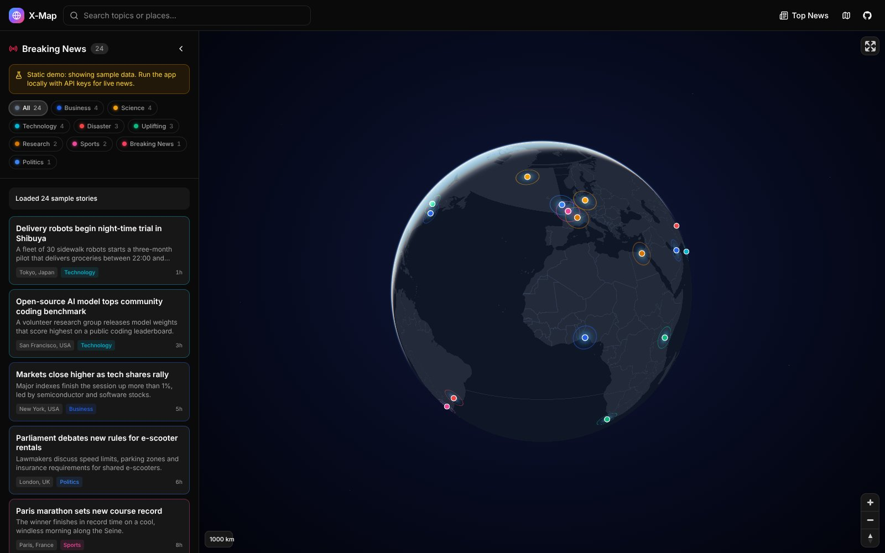
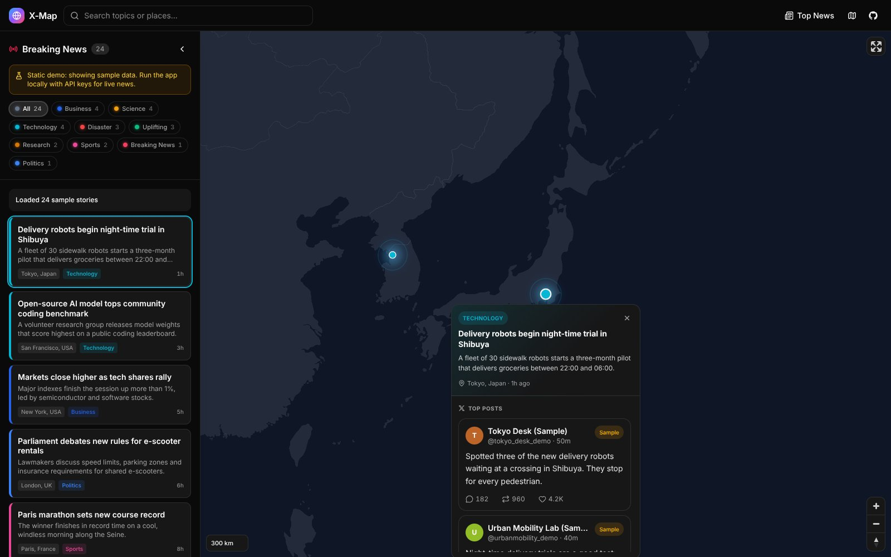
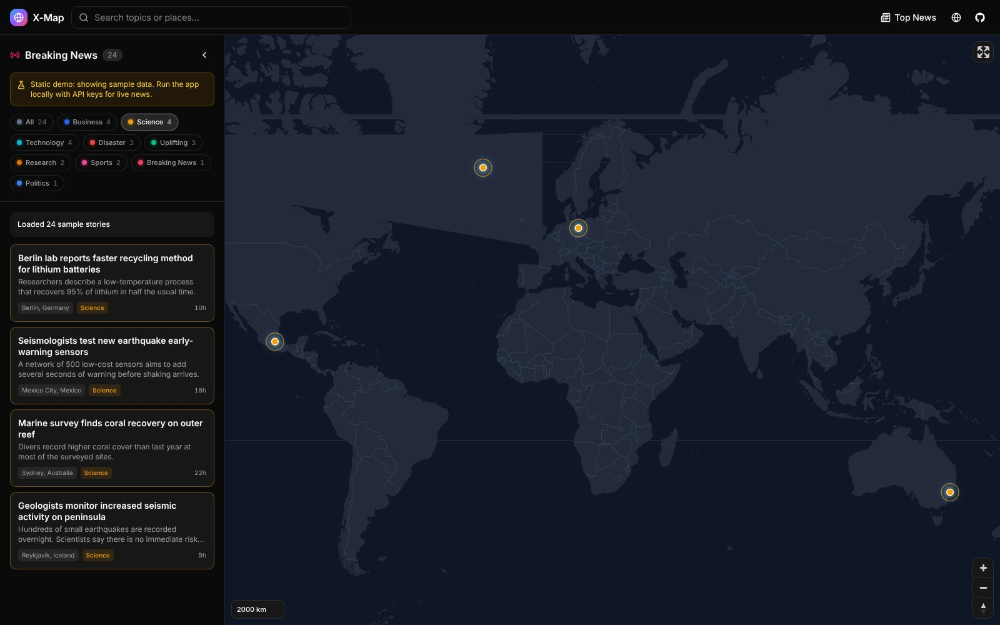
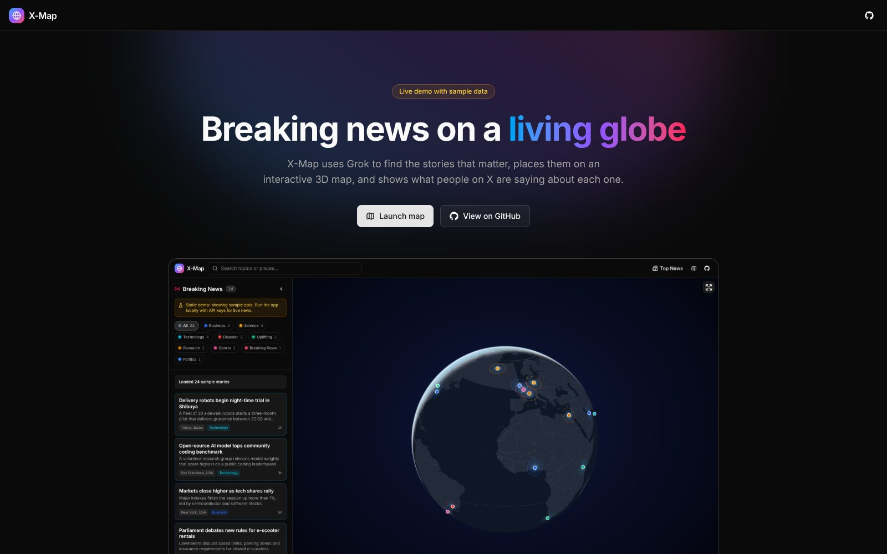
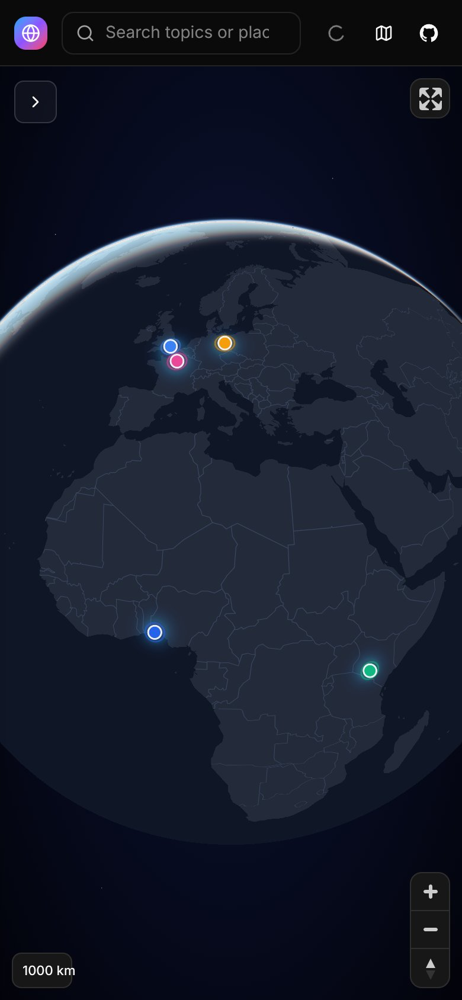
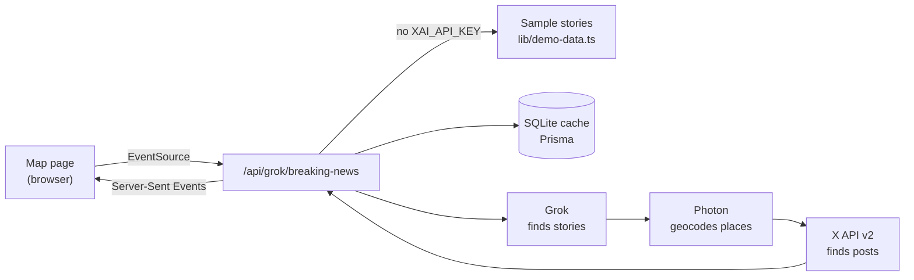

<div align="center">

# X-Map

**Breaking news on a living 3D globe.**
Grok finds the stories. The X API adds the conversation. MapLibre GL draws the globe.

[](https://github.com/manavhirani/x-map/actions/workflows/ci.yml)
[](https://github.com/manavhirani/x-map/actions/workflows/deploy-pages.yml)


[**Live demo**](https://manavhirani.github.io/x-map/) · [Quick start](#quick-start) · [Hosting](#hosting) · [How it works](#how-it-works) · [Architecture](docs/architecture.md)



</div>

## Features

- **Grok-curated news.** Grok finds high-impact stories from the last 7 days. The stories stream in one by one.
- **Posts from X.** Each story shows the top posts from the X API v2, with replies, reposts and likes.
- **3D globe or flat map.** A WebGL globe with an atmosphere glow and a star field, or a Mercator map.
- **Layered graphics.** A density heatmap at world zoom. Glowing, pulsing markers in category colours when you zoom in.
- **Category filters.** The filter chips come from the loaded stories. A filter zooms the map to the matching stories.
- **Works without keys.** With no API keys, the app shows 24 built-in sample stories.
- **Fast and light.** Memoised map data, a pulse animation capped at 30 fps, and no motion for users who prefer reduced motion.
- **Dark theme.** The app is dark-only.

## Screenshots

| Story details with posts | Category filter on the flat map |
| --- | --- |
|  |  |

| Landing page | Phone |
| --- | --- |
|  |  |

The screenshots show the built-in sample data. To make them again, run `npm run screenshots` (see [Scripts](#scripts)).

## Quick start

You need Node.js 20.9 or later.

```bash
git clone https://github.com/manavhirani/x-map.git
cd x-map
npm install
npm run dev
```

Open <http://localhost:3000> and select **Launch map**, then **Top News**.

With no API keys, the app shows sample data. A yellow notice in the sidebar tells you this.

### Use live data

1. Copy the example environment file:

   ```bash
   cp .env.example .env.local
   ```

2. Add your keys to `.env.local`. See [Configuration](#configuration).
3. Create the local SQLite cache:

   ```bash
   npm run db:push
   ```

4. Restart `npm run dev`.

## Configuration

All variables are optional.

| Variable | Used for | If it is not set |
| --- | --- | --- |
| `XAI_API_KEY` | Grok finds and summarises the stories. Get a key at [console.x.ai](https://console.x.ai/). | The app shows sample data. |
| `X_BEARER_TOKEN` (or `BEARER_TOKEN`) | The X API v2 adds posts to each story. Get a token at [developer.x.com](https://developer.x.com/en/portal/dashboard). | Stories show without posts. |
| `DATABASE_URL` | SQLite cache for stories, for example `file:./dev.db`. | The default is `file:./dev.db`. If the database does not exist, the app works without a cache. |
| `NEXT_PUBLIC_SITE_URL` | Absolute site URL for link previews. | On Vercel, the production domain. Otherwise `https://manavhirani.github.io/x-map`. |

The app ignores the placeholder values from `.env.example` (`your_..._here`).

### Data modes

| `XAI_API_KEY` | `X_BEARER_TOKEN` | Result |
| :---: | :---: | --- |
| ✗ | any | Sample stories with sample posts |
| ✓ | ✗ | Live stories from Grok, no posts |
| ✓ | ✓ | Live stories from Grok, with posts from X |

## How it works



1. The map page opens a Server-Sent Events stream to `/api/grok/breaking-news`.
2. Grok turns the search into a cache key and a scope (`global`, `region` or `local`).
3. The server sends cached stories for that key first, so the map fills quickly.
4. Grok reports new stories with tool calls. Photon geocodes each place. The X API finds posts.
5. The server sends each story as soon as it is ready, and saves it to the cache.

The static demo has no server. The browser makes the same events from the sample data. For more detail, see [docs/architecture.md](docs/architecture.md).

## Hosting

There are two ways to host X-Map. Both are free for a personal demo.

| | GitHub Pages | Vercel |
| --- | --- | --- |
| What runs | Static files only | The full Next.js app, with API routes |
| Data | Sample data | Sample data, or live data if you add keys |
| Setup | One setting, then push to `main` | Import the repository |
| URL | `https://<user>.github.io/x-map/` | `https://<project>.vercel.app` |

Both builds add link-preview tags (Open Graph and Twitter cards) with the globe screenshot. A link to the site in a portfolio or a post shows a preview card.

### Option A: GitHub Pages (static demo)

The workflow `.github/workflows/deploy-pages.yml` builds a static export with sample data and publishes it.

1. In the repository, go to **Settings → Pages**.
2. Under **Build and deployment → Source**, select **GitHub Actions**.
3. Push to `main`, or run the **Deploy demo to GitHub Pages** workflow by hand.

The site is then at `https://<user>.github.io/x-map/`.

To build the same export on your computer:

```bash
NEXT_PUBLIC_BASE_PATH=/x-map npm run build:demo   # writes the site to out/
```

The demo build uses `.tsx` files only, so Next.js leaves out the API routes (`route.ts`).

### Option B: Vercel (full app)

[](https://vercel.com/new/clone?repository-url=https%3A%2F%2Fgithub.com%2Fmanavhirani%2Fx-map)

1. Select the button above, or go to [vercel.com/new](https://vercel.com/new) and import the repository.
2. Keep the default settings. Vercel finds Next.js and runs `npm run build`.
3. Select **Deploy**.

With no environment variables, the site shows sample data.

> [!WARNING]
> If you add `XAI_API_KEY` or `X_BEARER_TOKEN` to a public deployment, every visitor uses your API credits. For a portfolio demo, do not add the keys.

On Vercel, the SQLite cache is not kept between requests. The app works without it, but each live search calls Grok again.

To use your own domain for link previews, set `NEXT_PUBLIC_SITE_URL` (for example `https://x-map.example.com`). On Vercel, the default is the production domain.

## Scripts

| Command | What it does |
| --- | --- |
| `npm run dev` | Starts the development server. |
| `npm run build` / `npm start` | Builds and starts the production server. |
| `npm run build:demo` | Builds the static demo into `out/`. |
| `npm run lint` | Runs ESLint. |
| `npm run typecheck` | Runs the TypeScript compiler. |
| `npm run db:push` | Creates or updates the SQLite database from `prisma/schema.prisma`. |
| `npm run screenshots` | Takes the README screenshots from a running server. Needs Playwright. |
| `npm run test:routes` | Calls every API route on a running server and reports the results. |
| `npm run cleanup` | Stops stale dev servers and removes Next.js lock files. |

## Project structure

```text
x-map/
├── app/
│   ├── page.tsx                      # Landing page
│   ├── map/page.tsx                  # Map page: state, stream, layout
│   └── api/
│       ├── grok/breaking-news/       # Main SSE endpoint
│       ├── geocode/                  # Place name → coordinates
│       └── x-api/                    # Older X API experiment routes
├── components/
│   ├── map/
│   │   ├── news-map.tsx              # MapLibre globe, layers, animation
│   │   ├── news-sidebar.tsx          # Story list and category filters
│   │   ├── news-card.tsx             # Story popup
│   │   └── tweet-card.tsx            # One post from X
│   ├── navbar.tsx
│   └── ui/button.tsx                 # shadcn/ui button
├── lib/
│   ├── types.ts                      # NewsItem, Tweet, stream event types
│   ├── demo-data.ts                  # Sample stories
│   ├── news-stream.ts                # Client: live SSE or in-browser demo
│   ├── categories.ts / format.ts     # Colours, number and time formats
│   └── server/                       # Grok, X API, geocoding, cache, SSE
├── prisma/schema.prisma              # SQLite cache schema
├── public/screenshots/               # README and landing page images
└── .github/workflows/                # CI and GitHub Pages deploy
```

## API

### `GET /api/grok/breaking-news?query=<topic>`

Returns a `text/event-stream`. `query` is optional. With no query, the server returns global top news.

Each event is one JSON object (type `NewsStreamEvent` in `lib/types.ts`):

| `type` | Fields | Meaning |
| --- | --- | --- |
| `connected` | `message` | The stream is open. |
| `mode` | `mode` (`live` or `demo`), `message` | The data source for this stream. |
| `status` | `message` | Progress text for the sidebar. |
| `news` | `news` (`NewsItem`) | One geolocated story. |
| `complete` | | The stream is done. |
| `error` | `message` | The stream failed. |

The routes under `/api/x-api/*` and `/api/geocode` are older experiments. The UI does not use them.

## Troubleshooting

| Problem | Fix |
| --- | --- |
| The sidebar says "showing sample data". | Set `XAI_API_KEY` in `.env.local` and restart the server. |
| Stories show "No posts available". | Set `X_BEARER_TOKEN`. The X API recent search also has rate limits. |
| "The map tiles could not load." | The CARTO basemap is not reachable. Check your network or firewall. |
| Port 3000 is in use, or a lock file error. | Run `npm run cleanup`, then `npm run dev`. |
| Prisma errors about the database. | Run `npm run db:push`. |

## Contributing

Contributions are welcome. Before you open a pull request, run:

```bash
npm run lint && npm run typecheck && npm run build
```

## License

This repository does not have a license file yet. Until the owner adds one, the default copyright rules apply.

## Acknowledgements

- [Next.js](https://nextjs.org/) and [React](https://react.dev/)
- [MapLibre GL JS](https://maplibre.org/) and [react-map-gl](https://visgl.github.io/react-map-gl/)
- Basemap © [CARTO](https://carto.com/attributions), map data © [OpenStreetMap](https://www.openstreetmap.org/copyright) contributors
- Geocoding by [Photon](https://photon.komoot.io/) (Komoot)
- [Grok](https://x.ai/) by xAI and the [X API](https://developer.x.com/)
