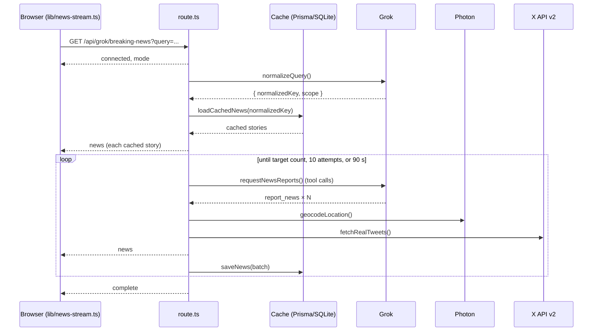

# Architecture

This document tells how X-Map gets stories, sends them to the browser, and draws them.

## Build targets

X-Map has two build targets. `next.config.ts` selects the target from `NEXT_PUBLIC_DEMO_MODE`.

| Target | Command | Output | Data |
| --- | --- | --- | --- |
| Server | `npm run build` | Next.js server with API routes | Live, or sample data if `XAI_API_KEY` is not set |
| Static demo | `npm run build:demo` | Static files in `out/` | Sample data only |

The static demo sets `pageExtensions: ["tsx"]`. Route handlers are `route.ts` files, so Next.js does not include them. Server-only code in `lib/server/` is imported only by routes, so it is not in the demo bundle.

## Data flow

### Server build

Files:

| File | Job |
| --- | --- |
| `app/api/grok/breaking-news/route.ts` | Selects live or sample data and opens the stream. |
| `lib/server/sse.ts` | Writes Server-Sent Events. Sends `connected` first and `complete` or `error` last. Stops when the client disconnects. |
| `lib/server/live-news.ts` | The live pipeline: cache, Grok, geocoding, posts, save. |
| `lib/server/grok.ts` | Calls the xAI chat-completions API. |
| `lib/server/x-api.ts` | Calls X API v2 recent search. Tries 3 query variants. Stops on HTTP 429. |
| `lib/server/geocode.ts` | Calls Photon with a 5 s timeout. |
| `lib/server/news-cache.ts` | Reads and writes the cache. If the database is not available, it logs a warning and continues. |
| `lib/server/env.ts` | Reads keys. Treats empty and placeholder values as "not set". |

### Sample data

`lib/demo-data.ts` holds 24 fictional stories in real places. `demoNewsEvents()` sends them as the same `NewsStreamEvent` objects as the live stream, with a short delay between stories. Both of these use it:

- The server route, when `XAI_API_KEY` is not set.
- `lib/news-stream.ts` in the static demo, where there is no server.

Sample posts have `isSample: true`. The UI shows a "Sample" badge on them. It shows no avatar lookup and no link, because the accounts are not real.

## Map rendering

`components/map/news-map.tsx` draws one GeoJSON source with five layers. The order is bottom to top:

| Layer | Type | Purpose |
| --- | --- | --- |
| `news-heat` | heatmap | Density glow at world zoom. Fades out by zoom 8. |
| `news-glow` | circle, blurred | Halo in the category colour. Brighter on hover. |
| `news-pulse` | circle, stroke only | Ring that grows and fades. |
| `news-core` | circle | The marker. Larger on hover and when selected. |
| `news-hit` | circle, transparent | Larger hover target. |

Other details:

- **Atmosphere.** The `sky` prop sets the globe glow. `atmosphere-blend` fades it out from zoom 5 to 7.
- **Space background.** The canvas is transparent outside the globe. The `.map-space` CSS class draws a star field behind it.
- **Hover and selection.** The source uses `promoteId: "id"`. Hover and selection use feature state, so the GeoJSON data does not change.
- **Pulse animation.** `usePulse` changes two paint properties with `requestAnimationFrame`, at about 30 fps. The browser pauses it in background tabs. It does not run when the user prefers reduced motion.
- **Auto-rotation.** `useAutoRotate` turns the globe slowly at world zoom. It stops for good when the user drags, scrolls or taps the map. It also stops when a story is selected or a filter is on.
- **Projection.** The projection is set after the style loads, because MapLibre throws an error if it is set before.
- **Memoisation.** The GeoJSON and the ID lookup are rebuilt only when the stories change.

## Client state

`app/map/page.tsx` owns the state:

- `items`: all stories from the current stream. Duplicates (same ID, or same headline and place) are dropped.
- `filter`: the selected category key. `visibleItems` is derived with `useMemo`.
- `selectedId`: the pinned story. A selection flies the map to the story and opens its popup. Hover opens a popup only when nothing is selected.
- `sidebarOpen`: `null` means "use the default". CSS opens the sidebar on desktop and closes it on phones, so the server HTML and the client HTML are the same.
